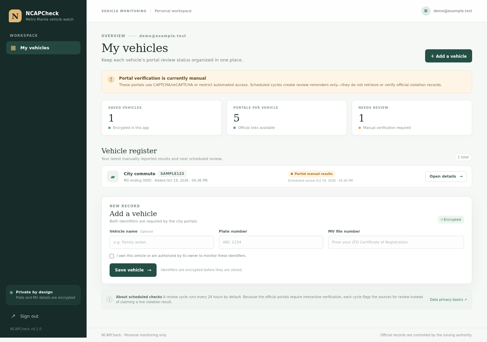
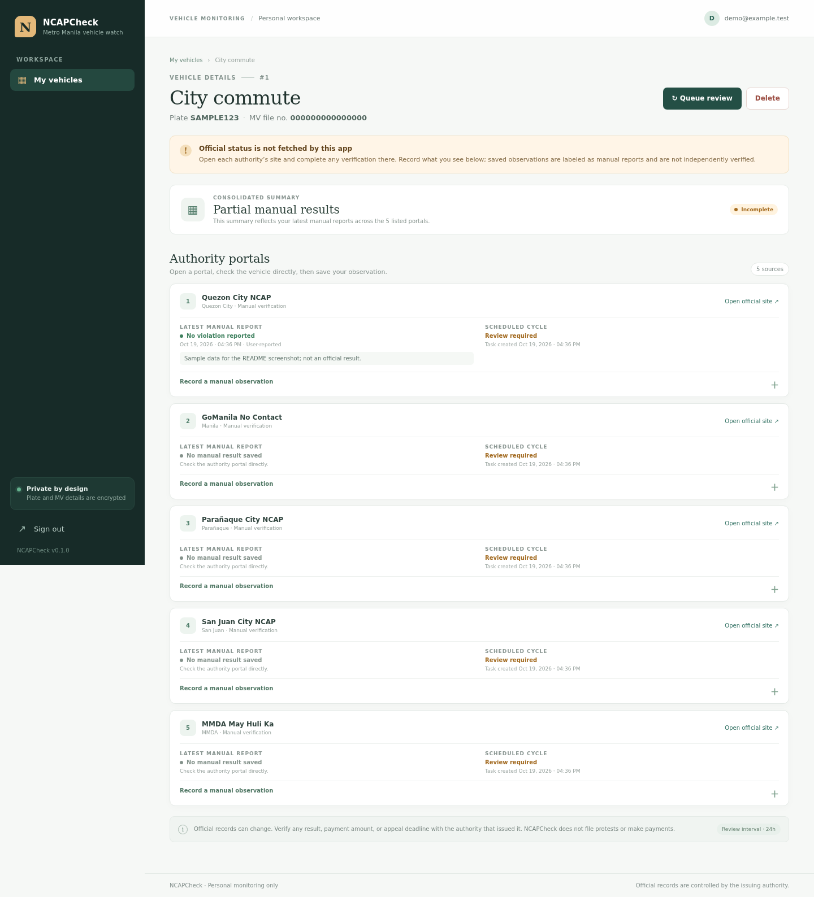
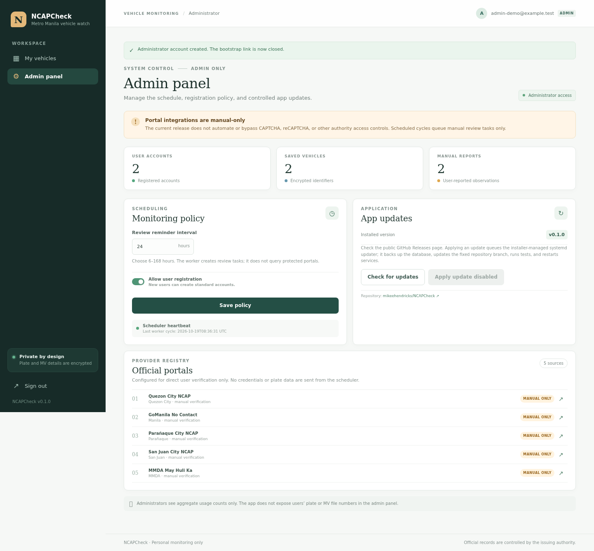

# NCAPCheck

A self-hosted, responsive dashboard for organizing vehicle identifiers and reviewing the five listed Metro Manila no-contact apprehension portals.

> **Important integration boundary:** NCAPCheck does **not currently retrieve official violation records automatically**. The portals we could inspect present interactive CAPTCHA/reCAPTCHA verification or block automated access; no approved public API credentials or endpoints were supplied. The scheduled worker therefore creates review reminders and never submits plate/MV data to those sites, bypasses verification, or claims an official clear/violation result. Users open the authority's portal themselves and may save a clearly labeled manual observation. An approved authority API can be connected later through `app/providers.py`.

## Screenshots

These screenshots use sample/demo data only; they do not show a real vehicle record. The admin screenshot was captured in local-development mode, where panel updates are disabled by default (the Ubuntu installer enables the managed updater).







## What is included

- **User accounts:** email/password sign-up, sign-in, CSRF protection, and per-user vehicle isolation.
- **Single-use admin bootstrap:** the Ubuntu installer generates a random setup token. The first admin registers once at `/setup-admin`; the route then closes, and a database constraint allows only one administrator.
- **Encrypted vehicle data:** plate number, MV file number, and optional manual notes are Fernet-encrypted before storage. Passwords are stored as one-way hashes. Keep the encryption key safe; losing it makes encrypted fields unreadable.
- **Five portal directory:** Quezon City, GoManila/Manila, Parañaque, San Juan, and MMDA May Huli Ka, each linked to its official website.
- **Periodic review queue:** configurable 6–168 hour interval; a separate APScheduler worker marks each source for manual review. This is a reminder workflow, not an automated NCAP lookup.
- **Manual observations:** record “violation shown,” “no violation shown,” or “unable to verify,” with optional encrypted notes. Consolidated summaries are labeled as user-reported and not authority-verified.
- **Admin panel:** aggregate-only usage counts, registration toggle, schedule settings, GitHub release check, and an optional fixed-command systemd updater.
- **Ubuntu deployment:** Nginx reverse proxy, Gunicorn/systemd web service, separate scheduler service, SQLite storage, update/backup scripts, and optional Let's Encrypt TLS setup.

## Portal support status

| Source | Portal | Current app behavior |
|---|---|---|
| Quezon City NCAP | [Check violations](https://nocontact.quezoncity.gov.ph/check-violations) | Direct link; manual verification required |
| Manila / GoManila | [No Contact](https://www.gomanila.com/nocontact) | Direct link; manual verification required |
| Parañaque City NCAP | [Check violations](https://paranaquecity.nocontact.ph/check-violations) | Direct link; manual verification required |
| San Juan City NCAP | [Check violations](https://nocontact.sanjuancity.gov.ph/check-violations) | Direct link; manual verification required |
| MMDA May Huli Ka | [May Huli Ka](https://mayhulika.mmda.gov.ph/) | Direct link; manual verification required |

Do not treat a manually entered observation or a missing result as a legal/official status. Verify notices, deadlines, appeals, and payment instructions directly with the issuing authority.

## Requirements

- A fresh or dedicated **Ubuntu 22.04 LTS or later** server with sudo/root access.
- DNS pointing to the host plus ports 80/443 open if you want the installer to request HTTPS automatically.
- GitHub repository populated on its `main` branch before cloning/installing.

The installer intentionally refuses non-Ubuntu systems and non-empty unexpected install directories. It installs Python, Nginx, SQLite, Git, and the Python dependencies inside a virtual environment.

## Install on Ubuntu

1. Make sure this repository has been pushed to GitHub and the `main` branch is available.
2. On the Ubuntu server, run:

   ```bash
   git clone https://github.com/mikeehendricks/NCAPCheck.git
   cd NCAPCheck
   sudo DOMAIN=app.example.com CERTBOT_EMAIL=admin@example.com bash scripts/install-ubuntu.sh
   ```

   Replace the domain/email with values you control. If you do not yet have DNS/TLS, omit both variables; the installer will warn that the HTTP-only install is not safe for public login/data use. Do not expose the app publicly over plain HTTP.

3. Save the one-time administrator token printed by the installer, then open `https://app.example.com/setup-admin`. Create the admin account. The setup endpoint closes after the first successful registration.
4. Users can register at `/register` unless the administrator disables public registration.

The install creates:

- App: `/opt/ncapcheck`
- Environment secrets and Fernet key: `/etc/ncapcheck/ncapcheck.env` (root-owned, group-readable by the app account)
- SQLite database: `/var/lib/ncapcheck/ncapcheck.db`
- Backups: `/var/backups/ncapcheck/`
- Web service: `ncapcheck.service`
- Scheduler: `ncapcheck-worker.service`
- Updater: `ncapcheck-update.service`

Useful commands:

```bash
sudo systemctl status ncapcheck ncapcheck-worker nginx
sudo journalctl -u ncapcheck -u ncapcheck-worker -f
sudo /usr/local/sbin/ncapcheck-backup
```

**Back up both** the SQLite database and `/etc/ncapcheck/ncapcheck.env` securely. The environment file contains the encryption key and application secrets; never commit it or share it. A database-only backup cannot decrypt vehicle records without the matching key.

## Updates

The admin panel can check GitHub Releases. “Apply update” queues a fixed, installer-managed systemd updater (not arbitrary shell input); it backs up the database, fast-forwards the fixed `main` branch, installs dependencies, runs the test suite, then restarts the app and worker. The updater is available only when installed by `scripts/install-ubuntu.sh` and enabled in the app environment.

For a manual update, use a maintenance window and follow the repository's update script. Database schema changes should be accompanied by migrations before future production releases; the current first release uses SQLAlchemy `create_all` and does not yet ship a migration framework.

## Local development

```bash
python3 -m venv .venv
. .venv/bin/activate
pip install -r requirements-dev.txt
cp .env.example .env
```

Generate secrets and replace the placeholders in `.env`:

```bash
python -c 'import secrets; print(secrets.token_hex(32))'
python -c 'from cryptography.fernet import Fernet; print(Fernet.generate_key().decode())'
```

Then run:

```bash
python -m flask --app run:app run --debug
```

Visit `http://127.0.0.1:5000/setup-admin` with the token set in `.env`, or register a standard user at `/register`. For local development only, `SESSION_COOKIE_SECURE=false` is expected.

## Tests performed

From the project root:

```bash
pip install -r requirements-dev.txt
pytest -q
bash -n scripts/install-ubuntu.sh scripts/update-server.sh scripts/backup.sh
```

The included suite covers registration/login, one-time admin bootstrap, authorization and vehicle ownership, encrypted fields, manual reports, scheduler behavior, admin settings, update behavior, and CSRF. **Most recent local run: 20 tests passed.** The implementation was also exercised in a headless browser for sign-in, adding a vehicle, saving a manual report, one-time admin setup, and a 390px-wide responsive layout. See the [detailed test report](docs/TEST-REPORT.md).

**Deployment validation limit:** the sandbox used for development is Debian, not an Ubuntu server, and no target server credentials/host were provided. The Ubuntu installer was syntax-checked but has not been executed end-to-end on your server. Test first on a clean Ubuntu 22.04+ VM, review the generated environment/HTTPS setup, and then deploy to production.

## Security / privacy notes

- Only add vehicles you own or are authorized to monitor.
- Sensitive fields are encrypted at application level in SQLite. The app does not send plate/MV identifiers to the listed portals in this release.
- Admin views show aggregate counts and portal configuration, not individual users' vehicle numbers.
- Use HTTPS, restrict server access, keep packages and Ubuntu patched, and protect backups/secrets.
- NCAPCheck is an independent personal tracking tool, not an MMDA or city-government service.
